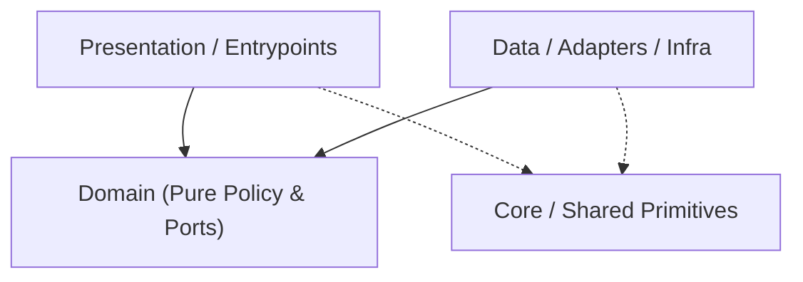

# Codebase Architecture Map — `switch-fs`

> Auto-generated by `project-pro map` (2026-11-07 08:15 UTC). Read this first to save exploration tokens.
- **Detected Stack**: `cpp-switch` | **Mode**: `configured`

## 1. Canonical Layer Dependency Flow

## 2. Layer Distribution (Code Files)
- **Domain**: `0` | **Data/Infra**: `0` | **Presentation/UI**: `29` | **Core/Shared**: `318` | **Tests**: `172` | **Other**: `118`

## 3. Module / Directory Index (Top Slices)
- `app/include/api/` — `1` files (`42` LOC)
- `app/include/utils/` — `1` files (`17` LOC)
- `app/src/utils/` — `1` files (`38` LOC)
- `library/borealis/demo/` — `17` files (`1164` LOC)
- `library/borealis/library/` — `617` files (`263518` LOC)
